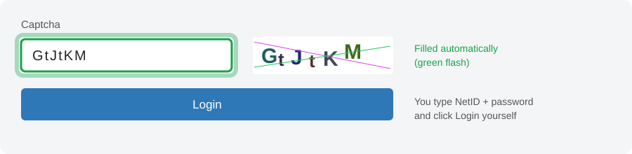
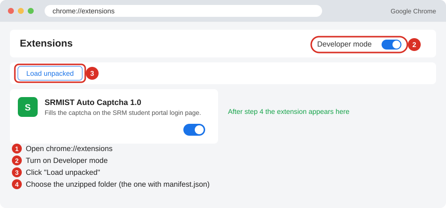
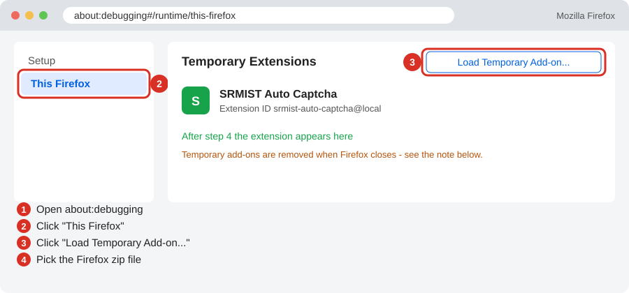

# SRMIST Auto Captcha Extension

Tired of typing the captcha on the SRM student portal? This extension fills it in for you.
Works in Chrome, Edge and Firefox. Runs offline, nothing leaves your browser.

## Download

Go to [Releases](https://github.com/Ferb029/SRMIST-Auto-Captcha-Extension/releases/latest) and download:

- **Chrome / Edge:** `srmist-auto-captcha-chrome-v1.0.zip` (unzip it)
- **Firefox:** `srmist-auto-captcha-firefox-v1.0.zip` (don't unzip)

## Install

### Chrome / Edge

1. Go to `chrome://extensions` (Edge: `edge://extensions`)
2. Turn on **Developer mode**
3. Click **Load unpacked** and pick the unzipped folder

### Firefox

1. Go to `about:debugging`
2. Click **This Firefox** → **Load Temporary Add-on...**
3. Pick the Firefox zip file

Firefox forgets temporary add-ons when you close it, so you'll need to load it again next time.
If it doesn't fill the captcha, open `about:addons` → SRMIST Auto Captcha → **Permissions and data** and turn on access to `sp.srmist.edu.in`.

## Use

Open the [SRM login page](https://sp.srmist.edu.in/srmiststudentportal/students/loginManager/youLogin.jsp).
The captcha box fills itself and flashes green. Type your NetID and password, then click Login.

If it can't read a captcha, the box stays empty. Just type it yourself or refresh for a new one.

## Credits

OCR model from [ddddocr](https://github.com/sml2h3/ddddocr), runtime from
[onnxruntime-web](https://www.npmjs.com/package/onnxruntime-web). Both MIT. For personal use.
